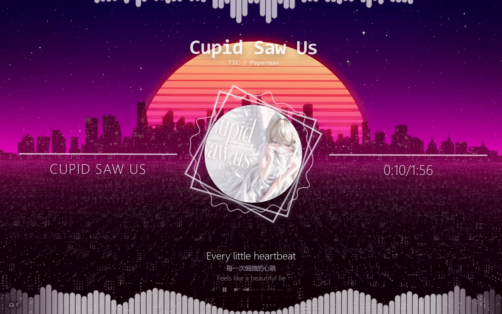

<div align="center">
  <strong>简体中文</strong> · <a href="./README.en.md">English</a>
</div>

<br />

<div align="center">
  <h1>Neon Radio</h1>
  <p>面向固定网易云账号的个人网页电台：主线播放、游客漫游、歌单同步与音频冲击可视化。</p>
  <p>
    
    
    
    
    
    
    
    
    
    
  </p>
</div>

<div align="center">
  
</div>

## 快速开始

要求 Node.js `20.12.0+` 和一个可用的 MySQL。

```bash
pnpm install
cp .env.example .env
```

在 `.env` 中至少填写 `NETEASE_UID`、`NETEASE_COOKIE_ENCRYPTION_KEY` 和 `DB_*`。然后运行：

```bash
pnpm start
```

- 前端：<http://localhost:3003>
- 服务端：<http://localhost:4003/neon-radio>

## 功能

- **主线电台**：服务端维护唯一播放时钟，所有听众共享歌曲和进度。
- **游客漫游**：管理员可放行游客自行选歌、拖动与切歌，不影响主线。
- **强制主线同步**：管理员可把自己的播放状态推送到主线。
- **歌单漫游**：定时同步账号下全部歌单，增量补齐详情后事务替换，按歌名与歌手去重；下线歌曲的歌词、副歌和时间轴一并清理。
- **歌词与副歌**：按需拉取并入库，重复收听直接读库；副歌段触发光柱视觉。
- **在线人数**：左下角显示在线人数，悬停展开在听人数最多的前 10 首。
- **扫码登录**：二维码登录、Cookie 加密入库、定时刷新、失效后重新扫码。

## 工作方式

```text
浏览器
  │  /neon-radio/*（Next.js 同源代理）
  ▼
Next.js（3003）
  ▼
Fastify（4003）
  ├─ modules/*        会话、漫游、播放、歌词、副歌、设置
  ├─ audio/*          下载 → ffmpeg → Worker 分析 → 时间轴入库
  ├─ platform/*       MySQL、网易云适配、Cookie、加密
  ├─ vendor/ncm-api   内置网易云接口（只读）
  └─ MySQL
```

## 技术栈

| 层级 | 主要依赖 |
| --- | --- |
| 前端 | Next.js 16（Turbopack）、React 19、TypeScript |
| 样式与组件 | Tailwind CSS 4、Radix UI、shadcn/ui 结构、Lucide、clsx、tailwind-merge、Sonner |
| 动画与视觉 | Framer Motion、GSAP、Canvas 2D、Web Audio API、WebGL2 |
| 服务端 | Fastify 5、@fastify/cookie、@fastify/express、@fastify/rate-limit、`ws` |
| 数据 | MySQL、mysql2、Drizzle ORM、drizzle-kit |
| 音频分析 | ffmpeg-static、Essentia.js、Worker Threads、execa |
| 网易云接口 | NeteaseCloudMusicApiEnhanced、`@neteasecloudmusicapienhanced/unblockmusic-utils` |
| 协议与校验 | `@neon-radio/protocol`（workspace）、zod |
| 工具链 | pnpm、tsx、concurrently、PM2、PostCSS |

## 项目结构

```text
neon-radio/
├─ packages/protocol/          前后端共享类型与校验
├─ frontend/src/audio/         音频层（播放、频谱、震动）
├─ frontend/src/features/radio/ 电台界面与实时连接
├─ server/modules/             业务模块
├─ server/audio/               音频层（下载、解码、分析）
├─ server/platform/            DB、HTTP、加密、网易云适配
└─ server/vendor/ncm-api/      第三方，只读
```

## 第三方资源

- **网易云接口**：[NeteaseCloudMusicApiEnhanced](https://github.com/NeteaseCloudMusicApiEnhanced)（仓库内以 `@neteasecloudmusicapienhanced/api` v4.41.1 内置）。仅用于个人电台，请遵守网易云音乐服务条款。
- **背景视频**：**"Synth City by Visualdon - 4K 60fps"**，作者 **VISUALDON**，来自 Wallpaper Engine。版权归原作者，仓库内的 `frontend/public/videos/loop.webm` 仅供演示；公开分发或商用前请自行取得授权或替换素材。
